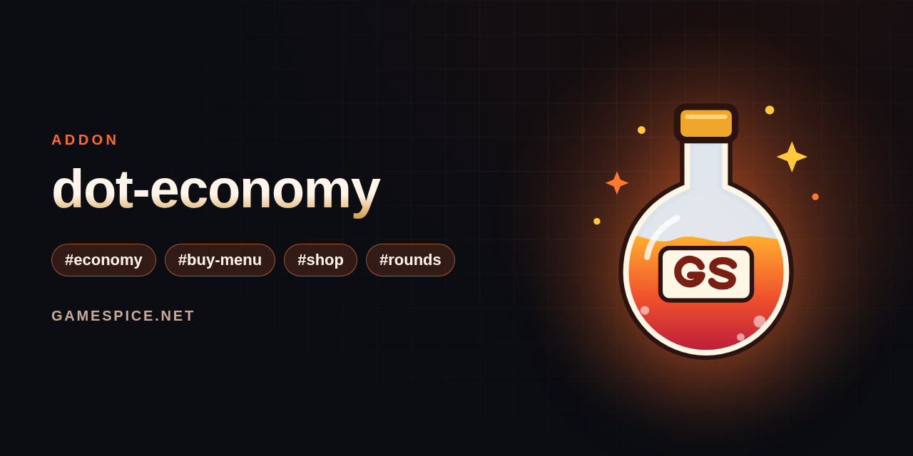

[](https://moddingcommunity.com/a/50-gs-economy)

A round-based buy economy for Godot 4.7+: money, a shop, a buy window, refunds, kill and round awards, and a loss bonus for a team that keeps losing. Part of the [GameSpice](https://github.com/gamespice-platform) family. It needs only [GameSpice Core](https://github.com/gamespice-platform/core).

GameSpice Economy is a GameSpice addon, MIT licensed and built with Claude Code, tested headless by `res://examples/economy_selftest.tscn`. The games in [Zee's Games](https://zeesgames.com) are built on the GameSpice addons and run on live servers, so the buy rules get used by real players.

Every player has a balance. A round opens a buy window, and players spend money in the shop while it is open, and by default while standing in a buy zone. Kills, round wins and objectives pay out. A purchase can be refunded for a short time.

The shop sells ids. It never hands out weapons or items. When somebody buys something, the `bought` signal fires and your game grants it. A server can therefore check a purchase without loading the item's scenes or models.

## Install

1. Copy `addons/gs_economy/` and `addons/gs_core/` into your project.
2. Enable gs-economy in *Project > Project Settings > Plugins*.

[GameSpice Bootstrap](https://github.com/gamespice-platform/bootstrap) clones every project and links the addons for you.

## Quick start

```gdscript
var economy := GSEconomyManager.new()
economy.team_fn = match_node.team_of
economy.alive_fn = world.is_alive
economy.in_buy_zone_fn = func(key): return world.in_buy_zone(key)
economy.setup(shop_items)           # an Array[GSShopItem]
add_child(economy)

economy.bought.connect(func(key, id, price, balance):
    loadouts.grant(key, id))

economy.on_round_start(tick)        # opens the buy window
economy.advance(tick)               # closes it when the buy time runs out
economy.buy("ada", &"rifle")        # a GSResult; bought fires if it went through
economy.on_kill("ada", "bob", &"rifle")
economy.on_round_end(winning_team)  # pays the winners and the loss bonus; 0 is a draw
```

`team_fn` must be set. Without it nobody is paid at the end of a round, and a warning says so. Teams are numbered from 1, because team 0 means nobody.

A buy menu can ask whether a purchase would work before it draws the button:

```gdscript
var why := economy.may_buy(key, &"sniper")
button.disabled = not why.ok
button.tooltip_text = "" if why.ok else why.error.message
```

## Shop items

Each `GSShopItem` has these fields.

| Field | What it does |
| --- | --- |
| `id` | The name your game grants when it is bought. |
| `price` | The cost. |
| `teams` | The teams that may buy it. |
| per-round and per-life limits | How many a player may buy. |
| `requires` | An item the player must already own. |
| `refundable` | Whether it can be refunded. |
| `kill_award` | Optional. Replaces the default for kills made with it, so a knife kill can pay more than a sniper kill. |

## Signals

| Signal | When it fires |
| --- | --- |
| `bought` | A purchase went through. Grant the item here. |
| `refunded` | A purchase was refunded. |
| `balance_changed` | A balance changed, with a reason such as `kill` or `loss_bonus`. |
| `buy_window` | The buy window opened or closed. |
| `award_capped` | Money was lost to the `max_money` ceiling, so a HUD does not show more than landed. |

A balance is private. `to_wire(key)` gives one player's account, and `apply_wire()` loads it on their client, where the manager has `authoritative` set to false.

## Settings

The rules live in a `GSEconomyRules` resource on the manager's `rules`. The manager makes a default one if you set none. Values layer in the usual order: inspector defaults, a JSON file, the environment, then the command line. Call `load_layered()` before `setup()`:

```gdscript
var rules := GSEconomyRules.new()
rules.load_layered("user://economy.json")
economy.rules = rules
```

```bash
GS_ECONOMY_START_MONEY=1000 godot --headless -- --economy-max-money=9000
```

All numbers are defaults and all are configurable. Ticks depend on your tick rate, and these assume 64 a second. The inspector sliders stop at 100000 (1000000 for `max_money`); set the property from code to go beyond them.

| Setting | Default | What it does |
| --- | --- | --- |
| `start_money` | 800 | Balance at the start of a match. |
| `max_money` | 16000 | Most a player can hold. |
| `keep_on_death` | true | Keep the balance when you die. |
| `reset_at_half` | true | Everybody returns to `start_money` at half time. |
| `kill_award` | 300 | Paid for a kill, unless the weapon sets its own. |
| `teamkill_penalty` | 3300 | Taken for killing a teammate. |
| `suicide_penalty` | 0 | Taken for killing yourself. |
| `win_award` | 3250 | Paid to each player on the winning team. |
| `loss_bonus_base` | 1400 | Paid to each player on the losing team. |
| `loss_bonus_step` | 500 | Added to the loss bonus for each loss in a row. |
| `loss_bonus_max` | 3400 | Highest the loss bonus goes. |
| `loss_bonus_resets_on_win` | true | A win resets the losing streak. |
| `objective_award` | 300 | Paid to each player on a team that completes an objective. |
| `buy_time_ticks` | 1280 | How long the buy window stays open (20 seconds). 0 keeps it open all round. |
| `require_buy_zone` | true | Only buy while standing in a buy zone. |
| `allow_buying_while_dead` | false | Let dead players buy. |
| `refund_ticks` | 320 | How long after a purchase it can be refunded (5 seconds). 0 turns refunds off. |
| `refund_fraction` | 1.0 | Share of the price a refund gives back. |
| `refund_within_buy_time` | true | Refund only while the buy window is open. |

The design is in [docs/design.md](docs/design.md).

## Test

```bash
godot --headless --path . --import
godot --headless --path . res://examples/economy_selftest.tscn
```

The self-test is offline. It covers balances and the ceiling, the buy window, buy zones, limits, refunds, awards, the loss bonus, half time and the network form of an account. It exits non-zero on any failure.

## Used by

Only one game vendors it so far.

- [Playlot](https://zeesgames.com/playlot) - the shop

The whole collection is at [zeesgames.com](https://zeesgames.com).

## Licence

MIT. See [LICENSE](LICENSE). Only the TMC back-end web infrastructure is not open source.
